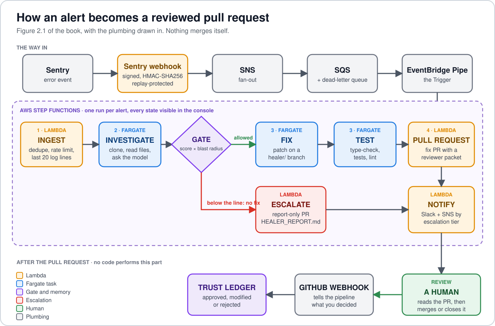

<div align="center">

# The Self-Healing Pipeline

### Companion code for the book *How I Taught My CI/CD Pipeline to Fix Itself at 2 AM*

**An error comes in. The pipeline finds the cause, writes a fix, tests it, and opens a pull request. A human decides.**
Run it on your laptop, break it on purpose, then put it on AWS and watch it work for real.

[](LICENSE)


[See it run](#see-it-run-in-a-minute) · [How it works](#how-it-works) · [Why you can trust it](#why-you-can-trust-it) · [Try it](#try-it) · [Follow the book](#follow-the-book) · [Honest limits](#honest-limits)

</div>

---

## What this is

The book describes a pipeline that detects a production error, diagnoses its root cause, proposes a fix, and learns from what
happens next, with a human in the loop for anything that matters. This repository is that pipeline as working code, plus every
listing from the book, built so that **you can experiment with it**: change a threshold and watch the decision change, feed in your
own incident, swap the AI model, then tear it all down.

- **Nothing needs an AWS account** until you decide you want one. The whole pipeline runs offline with a deterministic replay model.
- **Nothing merges itself, at any confidence.** The pipeline writes the pull request. A person clicks Merge.
- **It has been run for real:** real Sentry, real AWS, Bedrock, GitHub and Slack. Every hop was traced, and every log is saved in this
  repository (see [Why you can trust it](#why-you-can-trust-it)).

## See it run in a minute

```bash
git clone https://github.com/dharmendradevops11/the-self-healing-pipeline.git && cd the-self-healing-pipeline
make venv && make demo
```

```text
incident: AttributeError: 'NoneType' object has no attribute 'name'  (service demo-app, phase supervised, model replay)

=== result: pr_opened ===
root cause : get_display_name in src/auth.py dereferences session.user.profile, which is None for first-time OAuth users
confidence : model said 93, composite score 90 (high)
blast radius: low (1200 users)
decision   : auto_fix_pr, escalation tier informational -> platform-team
branch     : healer/2026-10-11-fix-src-auth-py-52ec9e
tests      : type-check: pass, unit: pass, lint: pass
pull request: .../prs/pr-1.md  labels: healer, healer: auto-fix-pr, healer: blast-radius-low, healer: human-review
audit steps: 6 written
```

It cloned a small app with a deliberate bug, asked a model for the cause, scored its own confidence, patched the bug on a `healer/`
branch, ran the app's tests, and wrote a pull request with a reviewer packet. **Now change one input and watch the decision change:**

| You change | Command | What the pipeline does |
|---|---|---|
| nothing (the happy path) | `make demo` | composite 90, high: opens a fix PR |
| the service touches payments | `python -m healer.demo --registry scenarios/registry-payments.json` | critical blast radius: expedited review, critical page |
| the model is less sure | see the command below the table | below 60: **no fix**, a report-only PR and an escalation |
| the alert is malicious | [experiment 5](docs/experiments.md) | the prompt-injection defences hold, and nothing runs |
| you want to watch without acting | `python -m healer.demo --phase shadow` | records what it *would* have done, takes no action |

For the "less sure" row, make a copy of the recorded model reply with a lower score and run that:

```bash
sed 's/"confidenceScore": 93/"confidenceScore": 20/' scenarios/replays/null-profile.json > /tmp/unsure.json
python -m healer.demo --replay /tmp/unsure.json
```

There are eight guided experiments in **[docs/experiments.md](docs/experiments.md)**.

## How it works

The architecture is Figure 2.1 of the book, with the plumbing the figure leaves out drawn in: an alert is verified, buffered and
handed to a workflow (top), the workflow investigates and then either proposes a fix or escalates (middle), and a person decides
(bottom). Every box inside the dashed frame is a Step Functions state you can click on in the AWS console.

<p align="center">
  
</p>

**The gate is the heart of it.** The model's own confidence is never trusted alone (Chapter 9):

| Step | What happens |
|---|---|
| 1. Composite confidence | `0.30` evidence **signal** + `0.45` model certainty + `0.25` historical accuracy for this kind of failure |
| 2. Band | low below 60, medium 60 to 84, high 85 and up |
| 3. Blast radius | how much breaks if the fix is wrong: low, medium, high, **critical** (payments, PII, or over 500,000 users) |
| 4. Escalation matrix | band × blast radius → `auto_fix_pr`, standard review, expedited review, or **investigation only** |

A model that says 95 about an error it has no evidence for gets a composite below 60, and the run goes to a human with a report,
not to a fix generator. This was seen on real AWS: [docs/aws-walkthrough.md](docs/aws-walkthrough.md#the-escalate-branch-run-exec-4898e06c-a-run-that-may-not-write-a-fix).

## Why you can trust it

**It was run for real, and the evidence is in the repo.**

| | |
|---|---|
| Automated tests | **570+**, all offline, plus integration tests against LocalStack |
| Real AWS runs, with every log saved | **18**, in [docs/runs/](docs/runs/) |
| Verified on real services | Sentry, SNS, SQS, EventBridge, Step Functions, Lambda, Fargate, Bedrock (Claude), GitHub, Slack |
| Bugs that only a real deployment found | **more than a dozen**, each fixed and covered by a test ([docs/aws-test-log.md](docs/aws-test-log.md)) |
| Teardown | tested for real: the account was checked and left empty |

**The walkthrough follows one alert through every hop** (webhook, SNS, SQS, the pipe, each Step Functions state, each Fargate task,
the pull request, Slack, the ledger) with the request or log line at each step and a link to where to see it in the AWS console:
**[docs/aws-walkthrough.md](docs/aws-walkthrough.md)**.

**Safety is designed in, not bolted on:**

| Control | What it does |
|---|---|
| Human merges, always | There is no merge code in this repository. The pipeline opens pull requests only |
| Path allowlist | The model may change `src/`, `lib/`, `app/`, `packages/`. Never workflows, infrastructure, migrations, scripts or tests |
| Four-layer prompt-injection defence | Sanitiser, `<untrusted_telemetry>` fencing, a classifier that fails closed, and sandbox plus IAM |
| Signed, fresh, bounded webhooks | HMAC-SHA256 on the raw body, constant-time compare, a 300-second replay window, a size cap |
| Secrets fetched at use | Never in environment variables, never in logs; rotation overlaps so nothing breaks mid-incident |
| Least privilege with explicit denies | One IAM role per stage. No role can touch IAM, billing, table deletion, or delete the audit trail |
| Audit trail | One JSON file per step in a locked-down bucket (Object Lock, Governance mode, 90 days). It holds the sanitised input and scrubbed output of each step, not the raw prompt. See [what is kept](docs/audit-retention.md) |
| Rate limits and caps | Three investigations per service per hour, three PRs a day, duplicate alerts run once |
| Phased rollout | Shadow mode, then supervised, then autonomous with hard limits |

## Try it

You need Python 3.11 (through [uv](https://docs.astral.sh/uv/)). Docker is needed only for LocalStack.

### 1. On your laptop (free, offline)

```bash
make venv        # Python 3.11 environment with the book's pinned versions
make test        # the whole test suite, no AWS and no Docker
make demo        # the pipeline end to end with a replay model and real git
```

### 2. On LocalStack (a local AWS)

```bash
make local-up    # LocalStack 3.4: S3, DynamoDB, SQS, SNS, Secrets Manager (Chapter 17, "Start Local")
python -m healer.demo --localstack
make local-test  # the integration tests
```

### 3. On AWS (a few cents a run)

Store your secrets first, then deploy. Both are step by step in **[docs/deploy.md](docs/deploy.md)**.

```bash
./scripts/deploy.sh -c healer:github_repo_url=https://github.com/you/your-repo \
                    -c healer:github_secret_arn=<arn> -c healer:phase=shadow \
                    -c healer:bedrock_model_id=<a model enabled in your account>
```

Start in **shadow mode**: the pipeline analyses every failure and records what it would have done, without acting. Connect Sentry
with [docs/sentry-setup.md](docs/sentry-setup.md). When you are done, `./scripts/teardown.sh` removes everything
([docs/teardown.md](docs/teardown.md)).

**Cost.** Local mode is free. On AWS a run is a few cents, almost all of it the model; an idle deployment costs about a dollar a
month (two secrets). Set `healer:billing_alarm_usd` to be told if that changes.

### Test every flow yourself

`scripts/test_flows.py` drives each flow on a deployed copy: a fix, an escalation, a forged webhook, a duplicate alert, the learning
loop. [docs/aws-walkthrough.md](docs/aws-walkthrough.md#test-each-flow-yourself) has the table of commands and what you should see.

## Follow the book

Every code listing from the book is in [`chapters/`](chapters/), one folder per chapter, in reading order. Most are excerpts that
illustrate one idea; the ones that are complete, runnable Python are marked in each chapter's README.
[`companion_code/`](companion_code/) holds the reference implementations indexed in Appendix D, with tests.
**The book is the specification:** [docs/BOOK_SPEC.md](docs/BOOK_SPEC.md) lists what it promises and where this repository stands,
and [docs/book-to-code.md](docs/book-to-code.md) maps each chapter to its code.

<details>
<summary><b>All 19 chapters, with their listings</b></summary>

| # | Chapter | Listings |
|---|---|---|
| 1 | [The Real Cost of Pipeline Failures](chapters/chapter-01-the-real-cost-of-pipeline-failures/) | 3 |
| 2 | [Beyond the Marketing Buzzword: A Working Definition](chapters/chapter-02-beyond-the-marketing-buzzword-a-working-definition/) | 4 |
| 3 | [Triage and the 3 AM Alarm: What Machine Learning Actually Does in DevOps](chapters/chapter-03-triage-and-the-3-am-alarm-what-machine/) | 14 |
| 4 | [The 47 Dashboards Nobody Looked At](chapters/chapter-04-the-47-dashboards-nobody-looked-at/) | 11 |
| 5 | [The Alert That Cried Wolf 200 Times](chapters/chapter-05-the-alert-that-cried-wolf-200-times/) | 9 |
| 6 | [Detecting the Slow-Motion Outage](chapters/chapter-06-detecting-the-slow-motion-outage/) | 8 |
| 7 | [Remediation: When to Pull the Plug Automatically](chapters/chapter-07-remediation-when-to-pull-the-plug-automatically/) | 14 |
| 8 | [What Happens When You Give an AI Write Access](chapters/chapter-08-what-happens-when-you-give-an-ai-write/) | 8 |
| 9 | [The Trust Problem: Junior Swagger vs. Senior Scars](chapters/chapter-09-the-trust-problem-junior-swagger-vs-senior-scars/) | 7 |
| 10 | [So I Killed a Pod: Validating the Healer with Chaos](chapters/chapter-10-so-i-killed-a-pod-validating-the-healer/) | 4 |
| 11 | [The New Attack Surface: Security Risks of Autonomous Pipelines](chapters/chapter-11-the-new-attack-surface-security-risks-of-autonomous/) | 13 |
| 12 | [Why Visibility Looks Like Failure](chapters/chapter-12-why-visibility-looks-like-failure/) | 3 |
| 13 | [The State of Autonomous Pipelines: An Honest Assessment](chapters/chapter-13-the-state-of-autonomous-pipelines-an-honest-assessment/) | 7 |
| 14 | [One Team Is Easy. Two Hundred Services Is Not.](chapters/chapter-14-one-team-is-easy-two-hundred-services-is/) | 2 |
| 15 | [The ROI of Self-Healing: The Economics of Firefighting](chapters/chapter-15-the-roi-of-self-healing-the-economics-of/) | – |
| 16 | [Four Incidents the Pipeline Changed](chapters/chapter-16-four-incidents-the-pipeline-changed/) | – |
| 17 | [Start Local, Stay Local Until You Can’t](chapters/chapter-17-start-local-stay-local-until-you-cant/) | 9 |
| 18 | [Where Autonomy Fails: The True Limitations](chapters/chapter-18-where-autonomy-fails-the-true-limitations/) | – |
| 19 | [Appendices](chapters/chapter-19-appendices/) | – |

</details>

## The code, folder by folder

| Folder | What it does | Book |
|---|---|---|
| `healer/ingest` | Validates the webhook, dedupes, rate-limits, attaches the last 20 log lines | Ch 5, 11 |
| `healer/investigate` | Clones the repo, reads the implicated files, asks the model for a root cause | Ch 2, 3, 8 |
| `healer/gate` | Composite confidence, blast radius, the escalation matrix, the human-review flags | Ch 2, 9, 14 |
| `healer/fix`, `healer/test` | Writes and applies the patch, then verifies it | Ch 2, 7, 17 |
| `healer/pr`, `healer/notify` | The reviewer packet, the pull request, Slack and SNS by tier | Ch 9 |
| `healer/guardrails` | Sanitiser, secret scrubber, path allowlist, patch limits, trust phases | Ch 7, 11, 17 |
| `healer/ledger` | Step-level audit log, rollbacks, the trust ledger, reviewer-verdict feedback | Ch 9 |
| `healer/llm` | Bedrock (with region round-robin and a fallback model), plus a deterministic replay model | Ch 2, 14, 17 |
| `healer/library` | Detection, forecasting, remediation, chaos and SLO code from the middle chapters | Ch 3-14 |
| `infra/` | The AWS CDK stacks, and the IAM policy documents from Chapter 11 | Ch 17, App F |
| `scripts/` | Build, deploy, teardown, trace a run, export its logs, drive every flow | Ch 17 |
| `docker/` | The agent image and the webhook-receiver image | Ch 17 |
| `scenarios/` | A small app with one deliberate bug, sample incidents and replay files | |
| `docs/`, `appendices/` | Guides, decision records, the walkthrough, Appendices A to I | |

## Honest limits

This section is deliberately plain, because the book is.

- **A reference implementation, not a product.** It is built to teach and to experiment with, and to be read. Review and test everything
  in a staging account before it goes near production.
- **Proven on real AWS:** the webhook, the fix path, the escalate path, reviewer feedback into the ledger, shadow mode, the daily cap,
  Slack, and teardown. **Not yet exercised there:** the autonomous phase, multi-region Bedrock, and the model fallback.
- **One repository per deployment,** and the stack trace parser is tuned to the demo app's Python and Node frames.
- **The confidence score is a heuristic, not a probability.** The weights (30% evidence, 45% model certainty, 25% history) come from
  the book and have not been calibrated against measured outcomes, and a model's stated certainty is not a measured chance of being
  right. Treat 90 as "the evidence is strong", never as "90% likely correct". No precision or false-positive figures are published yet.
- **Generated code runs only in a throwaway Fargate task** with a path allowlist, a read-only view of the tests and no production
  credentials, but a path allowlist alone does not make arbitrary code safe to run. Keep review mandatory.
- **The learning loop starts empty.** The history input to the confidence score only activates once a failure category has five
  resolved reviewer verdicts.
- **Slack message and notification text** include the analysis and a link, and nothing from your secrets, but the incident text
  itself goes to the channel you choose.
- **Where this repository and the book disagree, the book is right** and the repository is the thing to fix. The deliberate
  differences, and the places where the book disagrees with itself, are in [docs/DECISIONS.md](docs/DECISIONS.md) and
  [docs/BOOK_SPEC.md](docs/BOOK_SPEC.md).

## Documentation

| | |
|---|---|
| [docs/experiments.md](docs/experiments.md) | Eight experiments to try first |
| [docs/aws-walkthrough.md](docs/aws-walkthrough.md) | One alert, hop by hop, on real AWS, with logs and console links |
| [docs/viewing-logs.md](docs/viewing-logs.md) | Where each hop's evidence is and how to read it |
| [docs/deploy.md](docs/deploy.md), [docs/sentry-setup.md](docs/sentry-setup.md), [docs/teardown.md](docs/teardown.md) | Putting it on AWS, connecting Sentry, taking it down |
| [docs/ARCHITECTURE.md](docs/ARCHITECTURE.md), [docs/DECISIONS.md](docs/DECISIONS.md) | How it is built, and why |
| [docs/RUNBOOK.md](docs/RUNBOOK.md), [docs/ONBOARDING.md](docs/ONBOARDING.md), [docs/troubleshooting.md](docs/troubleshooting.md) | Running it, adding a service, fixing it |
| [docs/shadow-mode.md](docs/shadow-mode.md) | Earning trust in phases |
| [docs/BOOK_SPEC.md](docs/BOOK_SPEC.md), [docs/book-to-code.md](docs/book-to-code.md) | The book as specification, and the chapter-to-code map |
| [appendices/](appendices/) | The book's nine appendices, tied to the code |

## Errata, versions and license

Corrections and issues go to this repository's issue tracker, and revisions are logged in
[`.manuscript_changelog.md`](.manuscript_changelog.md), as Appendix I describes. Tested versions follow Appendix E. See
[CONTRIBUTING.md](CONTRIBUTING.md) before opening a pull request.

The code is licensed under the Apache License 2.0, see [LICENSE](LICENSE). It is provided for educational and reference purposes,
without warranty of any kind.
